# Simplified CFD Model of the Human Vocal Folds

**Transient 2D OpenFOAM model with prescribed dynamic mesh · parametric vocal-fold geometry · mesh-dependency study · effect of glottal opening on airflow**

Project work, TU Bergakademie Freiberg, Institute of Mechanics and Fluid Dynamics (Apr – Sep 2024) · Team of three: Suraj Anand, Abhishek Hebbar, **Krishna Kumar Ramamurthi** · Supervisor: Dr.-Ing. Martin Heinrich

[📈 Results](#results) · [⚙️ Case files](openfoam_case_excerpts/) · [⚠️ Limitations](#scope-and-limitations)

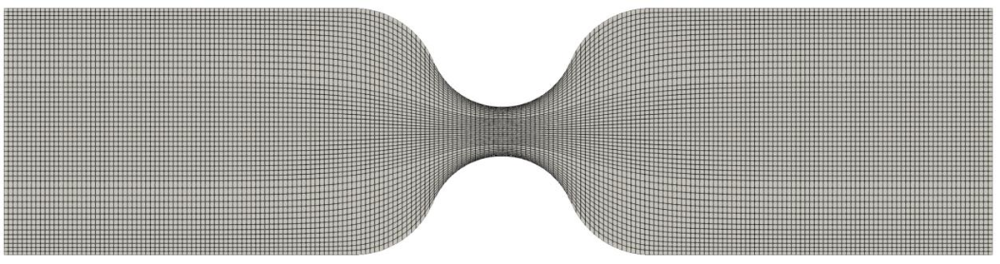
*Deformed computational mesh with the two vocal folds modelled as periodically opening and closing curved walls (H<sub>max</sub> = 2 mm, H<sub>min</sub> = 0.8 mm).*

## Project at a glance

| | |
|---|---|
| **Motivation** | Airflow through the glottis is the starting point for understanding aerosol generation during speech. |
| **What was built** | A simplified 2D larynx model in OpenFOAM in which the vocal-fold walls open and close periodically through a prescribed mesh motion. |
| **Engineering** | Parametric geometry (SolidWorks sweep + MATLAB polynomial fit), custom wall-motion law in C++, blockMesh, dynamic mesh, transient incompressible solution, probe monitoring, mesh-dependency study |
| **Result** | Fine mesh (324 × 72 cells) selected; wider glottal opening increased mass flow and reduced glottal velocity; asymmetric jet downstream of a symmetric glottis resolved only on the two finest meshes. |
| **Evidence** | Case-file excerpts, geometry fit script, result figures (this repository) |

## Method


### Geometry and motion

| | |
|---|---|
| 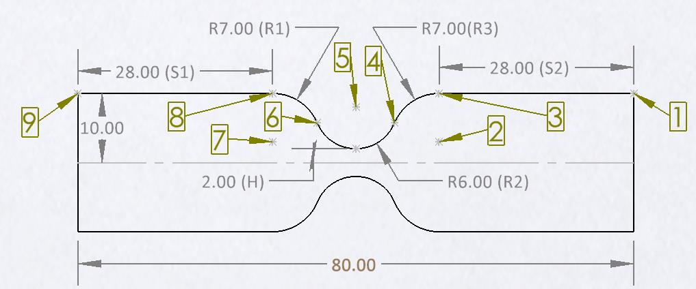 Vocal-fold contour: straight sections S1/S2 and arcs R1 = 7 mm, R2 = 6 mm, R3 = 7 mm | 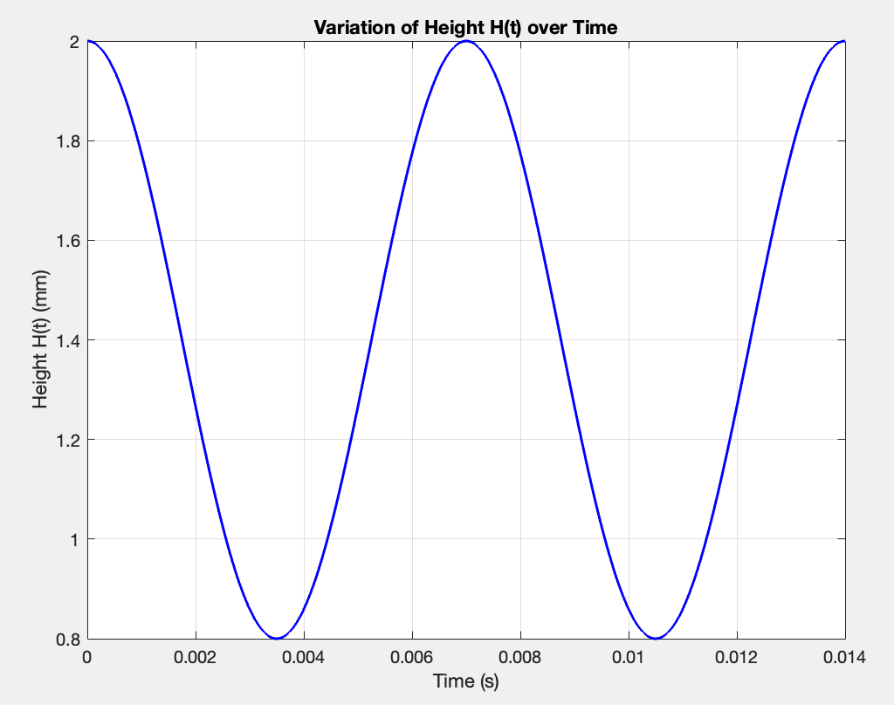 Prescribed glottal opening H(t) |

The glottal opening varies sinusoidally:

H(t) = (H<sub>max</sub> + H<sub>min</sub>)/2 + (H<sub>max</sub> − H<sub>min</sub>)/2 · cos(2π f t), with H<sub>max</sub> = 2 mm, H<sub>min</sub> = 0.8 mm, f = 142.8571 Hz (period 7 ms).

The arc radii are held constant while H changes, so the arc start, end and centre points move. Their positions were obtained by sweeping H from 0.4 to 2 mm in steps of 0.05 mm in SolidWorks and fitting each coordinate with a second-order polynomial in MATLAB ([script](matlab/fit_arc_centre_vs_H.m)). The resulting piecewise wall law moves every boundary point at each time step ([excerpt](openfoam_case_excerpts/src/vocalFoldWallMotion_excerpt.C)).

### Mesh and mesh motion

| | |
|---|---|
| 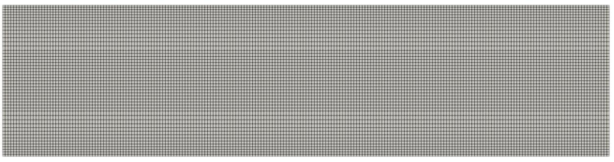 Initial blockMesh (80 mm × 20 mm channel) |  Deformed mesh |

A direct deformation from the undeformed channel to H<sub>max</sub> = 2 mm distorted the mesh. The mesh was therefore deformed in stages (10 → 6 mm, then in steps down to 2/0.8 mm), and the final point positions were written back to `constant/polyMesh` as the starting mesh.

### Case setup

| Item | Configuration |
|---|---|
| Software | OpenFOAM 11 |
| Domain | 2D channel, 80 mm × 20 mm, one cell in depth (0.1 mm), front/back `empty` |
| Inlet | Fixed kinematic pressure 1054.85 m²/s² (1250 Pa / 1.185 kg/m³) |
| Outlet | `entrainmentPressure`, p₀ = 0 |
| Time integration | `backward`; PIMPLE with 2 correctors |
| Convection | `Gauss LUST grad(U)` |
| Linear solvers | GAMG (p), PCG/DIC (pcorr, cellMotionUy), smoothSolver/symGaussSeidel (U) |
| Simulated time | 0.014 s (two oscillation periods) |
| Monitoring | Velocity at four probes (two upstream, two downstream of the glottis); inlet mass-flow rate |

## Results

### Mesh-dependency study

| Mesh | Cells (x × y) | Computation time* |
|---|---|---|
| Coarse | 144 × 32 | 90 min |
| Medium | 216 × 48 | 144 min |
| **Fine (selected)** | **324 × 72** | **228 min** |
| Refined | 486 × 108 | 420 min |

\*MacBook Pro, 0.014 s simulated time.

| | |
|---|---|
| 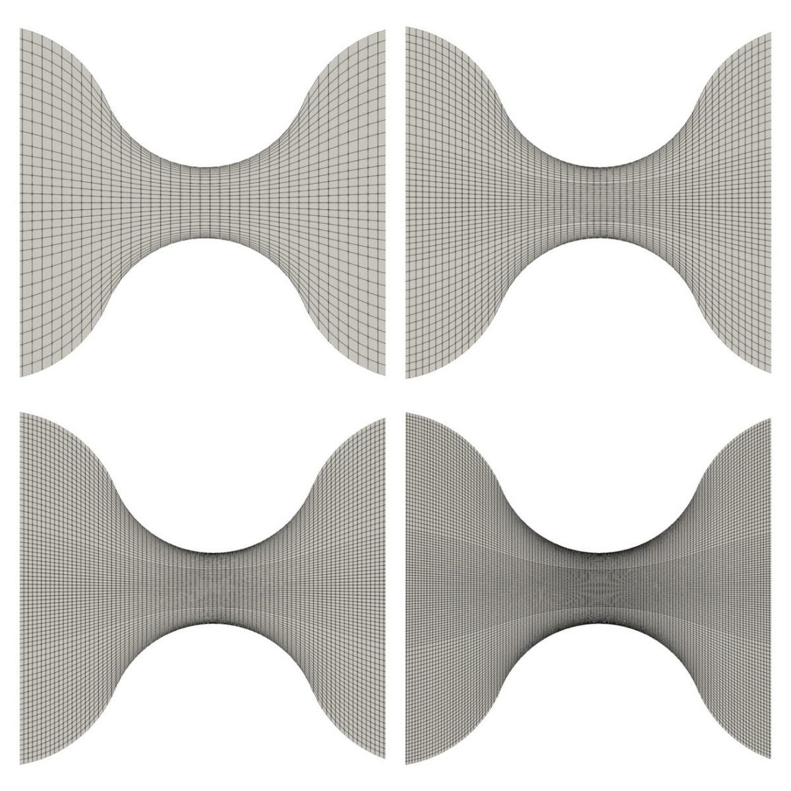 Coarse, medium, fine, refined mesh | 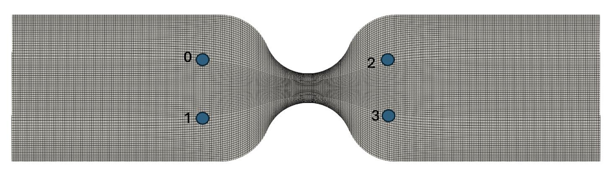 Probe locations |
| 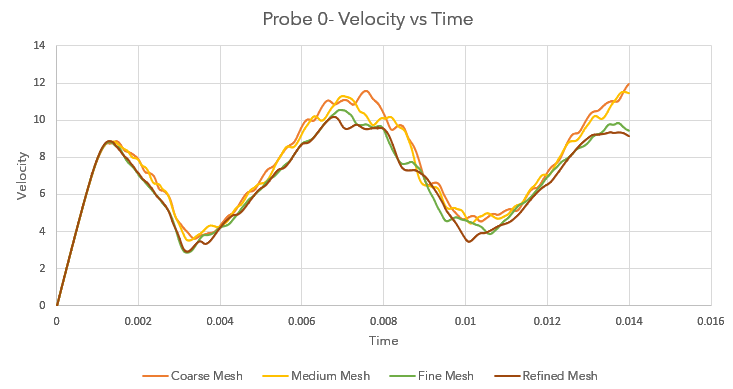 Probe 0 (upstream) | 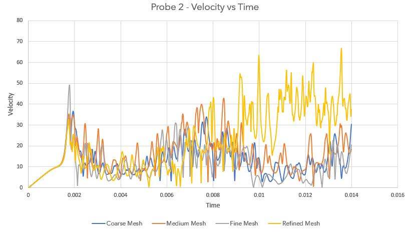 Probe 2 (downstream) |
| 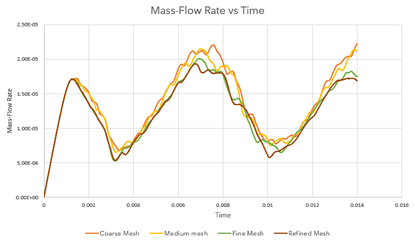 Inlet mass flow | 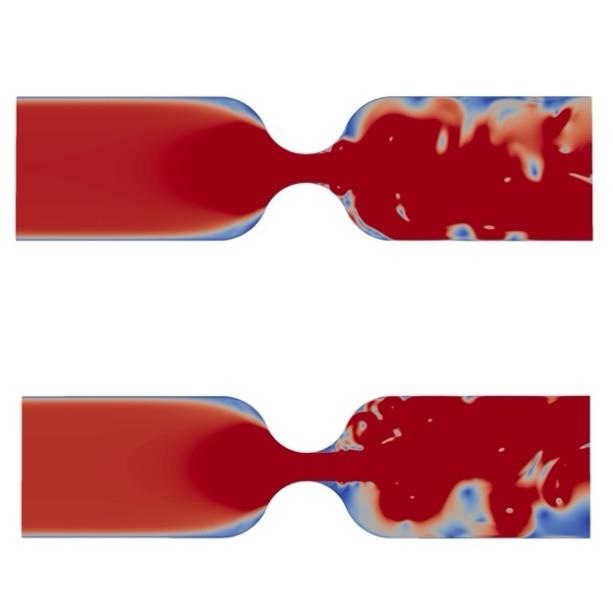 Velocity at t = 0.014 s, fine (top) and refined (bottom) |

- **Upstream probes (0, 1):** fine and refined meshes give practically identical velocity histories; coarse and medium deviate at the peaks.
- **Inlet mass flow:** the coarse mesh is the most oscillatory; fine and refined are close.
- **Downstream probes (2, 3):** the jet region behind the glottis shows strong high-frequency fluctuations, and the signals differ between all four meshes, including fine and refined. The local downstream flow is therefore not mesh-independent.
- **Flow asymmetry:** although the geometry is symmetric, the downstream jet becomes asymmetric. Only the fine and refined meshes resolved this.

The fine mesh was selected as the compromise between accuracy of the global quantities and computation time.

### Effect of glottal opening (fine mesh)

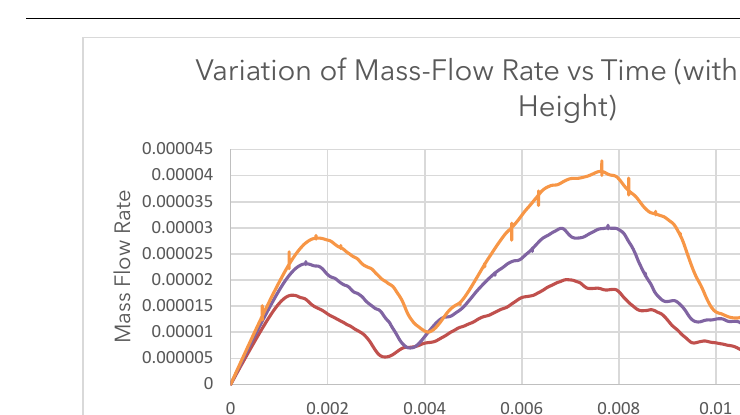

| Glottal height range H<sub>min</sub>–H<sub>max</sub> | Max. mass-flow rate** | Glottal velocity |
|---|---|---|
| 0.8–2 mm | 2·10⁻⁵ kg/s | 9.7 m/s |
| 1.2–3 mm | 3·10⁻⁵ kg/s | 7.6 m/s |
| 1.6–4 mm | 4·10⁻⁵ kg/s | 6.5 m/s |

\*\*For the 0.1 mm-thick 2D domain.

| 0.8–2 mm | 1.2–3 mm | 1.6–4 mm |
|---|---|---|
| 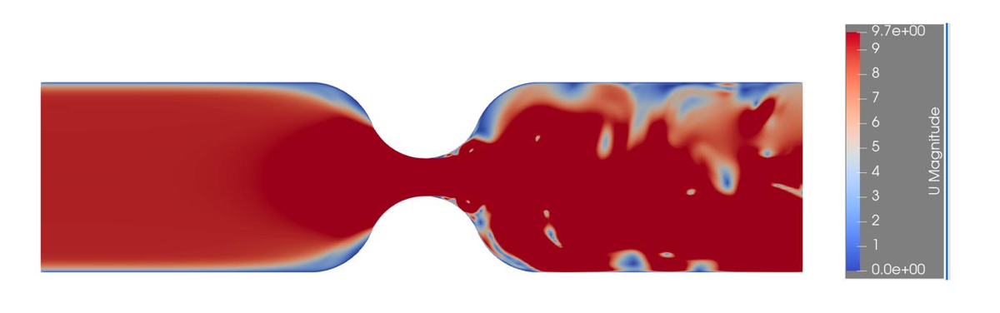 | 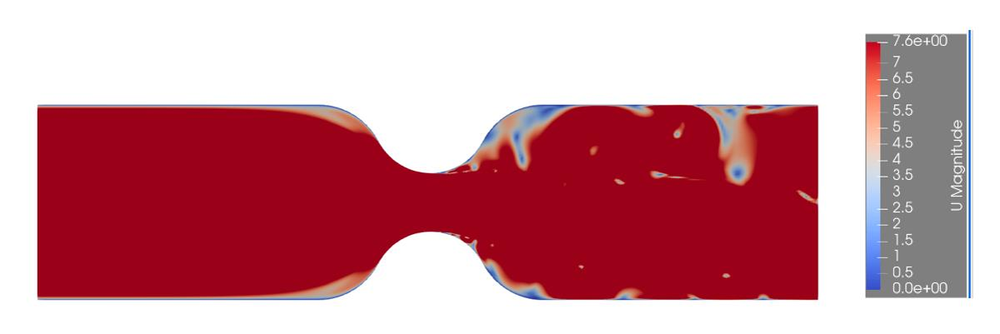 | 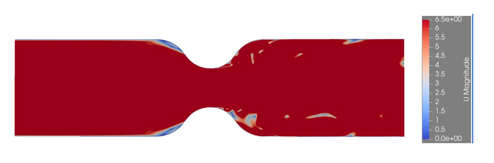 |

At the same imposed pressure difference, a wider glottal opening passes more mass flow at a lower glottal velocity.

## Scope and limitations

- 2D planar model; the real glottis is three-dimensional.
- Wall motion is prescribed (sinusoidal); there is no fluid–structure interaction.
- Only two oscillation periods were simulated, so the start-up transient is included and a periodic state was not demonstrated.
- The downstream jet region is not mesh-converged (see probes 2 and 3).
- Aerosol formation itself was not simulated; the model covers the airflow only.
- No experimental validation within this project.

## My contribution

**[TO BE COMPLETED: your own share of the team work]**

## Repository structure

```
openfoam_case_excerpts/
  0/p                              pressure boundary conditions
  system/blockMeshDict             base mesh (fine mesh resolution)
  system/fvSchemes                 discretisation schemes
  system/fvSolution                linear solvers, PIMPLE settings
  system/controlDict.functions     probes and inlet flow-rate monitoring
  src/vocalFoldWallMotion_excerpt.C  core of the prescribed wall-motion law
matlab/fit_arc_centre_vs_H.m       polynomial fit of geometry points vs H
docs/images/                       geometry, meshes, probe and contour results
```

The case files are excerpts documented in the project report, not a complete runnable case.

## References

1. Zhao, W., Zhang, C., Frankel, S. H., Mongeau, L. (2002). Computational aeroacoustics of phonation, Part I: Computational methods and sound generation mechanisms. *J. Acoust. Soc. Am.* 112(5), 2134–2146.
2. Scherer, R. C., Shinwari, D., De Witt, K. J., Zhang, C., Kucinschi, B. R., Afjeh, A. A. (2001). Intraglottal pressure profiles for a symmetric and oblique glottis with a divergence angle of 10 degrees. *J. Acoust. Soc. Am.* 109(4), 1616–1630.

## License

- OpenFOAM case files and wall-motion code: GNU GPL v3, see [LICENSE](LICENSE) (same licence as OpenFOAM)
- Figures and documentation: © Suraj Anand, Abhishek Hebbar, Krishna Kumar Ramamurthi, provided for reference
